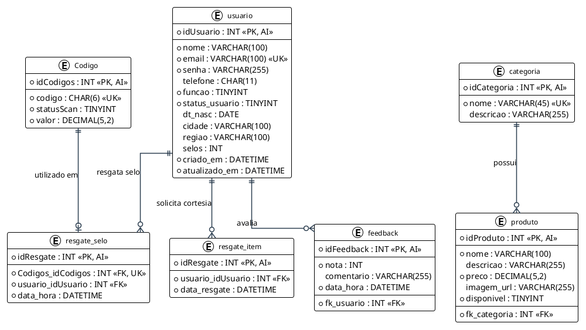

# Hachi Crepe e Taiyaki - Banco de Dados

Modelagem relacional, diagramas visuais e scripts de banco de dados do sistema de fidelidade e cardápio digital da **Hachi Crepe e Taiyaki**, desenvolvidos pela equipe **H8**, como **Projeto de Extensão** do 2º Período do Curso de Ciência da Computação da Faculdade São Paulo Tech School ([SPTech](https://sptech.school/)).

## Sumário

- [Sobre o projeto](#sobre-o-projeto)
- [Objetivos da modelagem](#objetivos-da-modelagem)
- [Tecnologias e ferramentas](#tecnologias-e-ferramentas)
- [Diagrama Entidade-Relacionamento (DER)](#diagrama-entidade-relacionamento-der)
  - [Visualização do Modelo Atual (V2.2)](#visualizacao-do-modelo-atual-v22)
  - [Geração de diagramas com PlantUML](#geracao-de-diagramas-com-plantuml)
- [Dicionário de dados](#dicionario-de-dados)
  - [Tabela `usuario`](#tabela-usuario)
  - [Tabela `categoria`](#tabela-categoria)
  - [Tabela `produto`](#tabela-produto)
  - [Tabela `Codigo`](#tabela-codigo)
  - [Tabela `resgate_selo`](#tabela-resgate_selo)
  - [Tabela `resgate_item`](#tabela-resgate_item)
  - [Tabela `feedback`](#tabela-feedback)
- [Histórico e evolução das versões](#historico-e-evolucao-das-versoes)
- [Pré-requisitos](#pre-requisitos)
- [Instalação e execução dos scripts](#instalacao-e-execucao-dos-scripts)
- [Estrutura de diretórios](#estrutura-de-diretorios)
- [Regras de integridade e negócio](#regras-de-integridade-e-negocio)
- [Integração com a API](#integracao-com-a-api)
- [Contribuição](#contribuicao)
- [Licença](#licenca)
- [Estratégia de Branches](#estrategia-de-branches)

---

## Sobre o Projeto

O repositório **Hachi Crepe e Taiyaki - Banco de Dados** concentra todos os artefatos de engenharia de dados do ecossistema de fidelidade e cardápio digital da casa de crepes e taiyakis orientais Hachi.

O banco de dados foi projetado para assegurar integridade referencial estrita, rastreabilidade transacional em acúmulo e resgate de selos de fidelidade, controle seguro de perfis de acesso e alta coesão com a camada de persistência da [hachi-crepe-taiyaki-api](file:///home/marley/hachi-crepe-taiyaki-api/README.md).

### Objetivos principais

- **Integridade Transacional de Fidelidade:** Registrar com atomicidade cada código emitido, selo resgatado e produto cortesia retirado, impedindo duplicações ou manipulações indevidas.
- **Catálogo de Produtos Estruturado:** Modelar a hierarquia de categorias e produtos do cardápio digital, com suporte a preços, descrições e controle de disponibilidade.
- **Gestão de Identidade e Perfis:** Armazenar dados cadastrais, hashes criptográficos de senha e níveis de autorização (Cliente, Funcionário e Administrador).
- **Preservação de Histórico (Soft Delete):** Permitir a desativação lógica de contas mantendo intactos registros de compras, resgates e auditorias.
- **Canal de Opinião do Cliente:** Suportar avaliações quantitativas (notas de 0 a 5) e qualitativas (comentários) vinculadas aos consumidores.

---

## Tecnologias e ferramentas

| Ferramenta / Tecnologia | Finalidade |
| --- | --- |
| **MySQL 8.0+** | Sistema Gerenciador de Banco de Dados Relacional (SGBD) para homologação e produção |
| **PlantUML** | Geração automatizada como código dos diagramas conceituais e lógicos em alta definição (PNG e SVG) |
| **MySQL Workbench** | Ferramenta visual CASE utilizada para modelagem gráfica dos arquivos `.mwb` |
| **SQL (ANSI DDL/DML)** | Scripts padronizados de criação de esquema, índices, integridade referencial e triggers |
| **H2 Database (Dialeto MySQL)** | Compatibilidade direta com o banco relacional em memória utilizado pela API para testes automatizados |

---

## Diagrama Entidade-Relacionamento (DER)

### Visualização do Modelo Atual (V2.2)

O diagrama abaixo representa a modelagem conceitual e lógica do banco de dados na **Versão 2.2**, gerado a partir do código PlantUML em [diagrams/der_v2.2.puml](file:///home/marley/hachi-crepe-taiyaki-database/diagrams/der_v2.2.puml):



> [!TIP]
> Também disponível em vetor de alta resolução: [diagrams/der_v2.2.svg](file:///home/marley/hachi-crepe-taiyaki-database/diagrams/der_v2.2.svg)

### Geração de diagramas com PlantUML

Os diagramas do projeto são declarativos (*diagrams as code*), permitindo versionamento contínuo de alterações de schema.

Para regenerar as imagens após modificar qualquer especificação em `diagrams/*.puml`:

```bash
# Gerar imagem em formato PNG
plantuml -tpng diagrams/der_v2.2.puml

# Gerar imagem vetorial em formato SVG
plantuml -tsvg diagrams/der_v2.2.puml

# Compilar todos os diagramas de uma só vez
plantuml -tpng diagrams/*.puml
```

---

## Dicionário de dados

### Tabela `usuario`
Armazena as contas de acesso de clientes, funcionários e administradores do ecossistema.

| Coluna | Tipo | Nulo | Chave | Descrição |
| --- | --- | --- | --- | --- |
| `idUsuario` | INT | Não | PK | Identificador único auto incremental do usuário. |
| `nome` | VARCHAR(100) | Não | - | Nome completo do usuário. |
| `email` | VARCHAR(100) | Não | UK | E-mail corporativo ou pessoal utilizado como login (único). |
| `senha` | VARCHAR(255) | Não | - | Hash criptográfico BCrypt da senha de acesso. |
| `telefone` | CHAR(11) | Sim | - | Número de telefone/WhatsApp com DDD (apenas dígitos). |
| `funcao` | TINYINT(3) | Não | - | Nível de acesso: `0` (Cliente), `1` (Funcionário), `2` (Administrador). |
| `status_usuario` | TINYINT | Não | - | Estado da conta: `1` (Ativo), `0` (Desativado/Exclusão lógica). |
| `dt_nasc` | DATE | Sim | - | Data de nascimento do cliente. |
| `cidade` | VARCHAR(100) | Sim | - | Município de residência. |
| `regiao` | VARCHAR(100) | Sim | - | Bairro ou região administrativa. |
| `selos` | INT | Não | - | Saldo consolidado de selos acumulados disponíveis para resgate. |
| `criado_em` | DATETIME | Não | - | Data e hora de criação do cadastro (padrão: `CURRENT_TIMESTAMP`). |
| `atualizado_em` | DATETIME | Não | - | Data e hora da última modificação cadastral. |

---

### Tabela `categoria`
Agrupa os itens do cardápio digital (ex.: Crepes Doces, Crepes Salgados, Taiyakis, Bebidas).

| Coluna | Tipo | Nulo | Chave | Descrição |
| --- | --- | --- | --- | --- |
| `idCategoria` | INT | Não | PK | Identificador único auto incremental da categoria. |
| `nome` | VARCHAR(45) | Não | UK | Nome de exibição da categoria no cardápio. |
| `descricao` | VARCHAR(255) | Sim | - | Breve descrição comercial dos produtos da categoria. |

---

### Tabela `produto`
Itens comercializados pela Hachi exibidos no cardápio digital e catálogo da aplicação.

| Coluna | Tipo | Nulo | Chave | Descrição |
| --- | --- | --- | --- | --- |
| `idProduto` | INT | Não | PK | Identificador único auto incremental do produto. |
| `nome` | VARCHAR(100) | Não | - | Nome comercial do produto. |
| `descricao` | VARCHAR(255) | Sim | - | Detalhamento dos ingredientes e apresentação. |
| `preco` | DECIMAL(5,2) | Não | - | Preço unitário em Reais (R$). |
| `imagem_url` | VARCHAR(255) | Sim | - | URL da fotografia de exibição do produto. |
| `disponivel` | TINYINT | Não | - | Flag indicativa de disponibilidade: `1` (Disponível), `0` (Indisponível). |
| `fk_categoria` | INT | Não | FK | Referência à chave primária `categoria(idCategoria)`. |

---

### Tabela `Codigo`
Tokens alfanuméricos gerados no balcão por funcionários para compras elegíveis (a partir de R$ 40,00).

| Coluna | Tipo | Nulo | Chave | Descrição |
| --- | --- | --- | --- | --- |
| `idCodigos` | INT | Não | PK | Identificador numérico interno auto incremental do token. |
| `codigo` | CHAR(6) | Não | UK | Código alfanumérico único de 6 caracteres gerado para o cliente. |
| `statusScan` | TINYINT | Não | - | Estado de uso: `0` (Disponível/Não utilizado), `1` (Resgatado). |
| `valor` | DECIMAL(5,2) | Não | - | Valor monetário total da compra associada ao código. |

---

### Tabela `resgate_selo`
Registra a transação em que um cliente resgata com sucesso um código para creditar um selo à sua conta.

| Coluna | Tipo | Nulo | Chave | Descrição |
| --- | --- | --- | --- | --- |
| `idResgate` | INT | Não | PK | Identificador único auto incremental da transação de acúmulo de selo. |
| `Codigos_idCodigos` | INT | Não | FK, UK | Referência única ao token consumido em `Codigo(idCodigos)`. |
| `usuario_idUsuario` | INT | Não | FK | Referência ao cliente beneficiado em `usuario(idUsuario)`. |
| `data_hora` | DATETIME | Não | - | Data e hora exatas da validação do selo. |

---

### Tabela `resgate_item`
Audita a operação em que o cliente atinge 12 selos e resgata um item cortesia como recompensa.

| Coluna | Tipo | Nulo | Chave | Descrição |
| --- | --- | --- | --- | --- |
| `idResgate` | INT | Não | PK | Identificador único auto incremental do resgate da recompensa. |
| `usuario_idUsuario` | INT | Não | FK | Referência ao cliente solicitante em `usuario(idUsuario)`. |
| `data_resgate` | DATETIME | Não | - | Registro cronológico da data e hora em que a cortesia foi resgatada. |

---

### Tabela `feedback`
Canal de avaliação e relacionamento com clientes da loja.

| Coluna | Tipo | Nulo | Chave | Descrição |
| --- | --- | --- | --- | --- |
| `idFeedback` | INT | Não | PK | Identificador único auto incremental da avaliação. |
| `nota` | INT | Não | - | Classificação de satisfação do cliente (escala restrita de 0 a 5). |
| `comentario` | VARCHAR(255) | Sim | - | Parecer textual opcional com sugestões, elogios ou críticas. |
| `data_hora` | DATETIME | Não | - | Timestamp do envio da avaliação. |
| `fk_usuario` | INT | Não | FK | Referência ao cliente autor em `usuario(idUsuario)`. |

---

## Histórico e evolução das versões

A modelagem de dados evoluiu com base nos testes com usuários e alinhamento de regras de negócio com o beneficiário:

### Versão 2.1 (`der_v2.1.puml` / `SCRIPT - V2.1.sql`)
- **Conceito:** Baseava-se no modelo clássico de "Cartão de Carimbos Físico", contendo tabelas acopladas como `cartao_fidelidade`, `carimbo` e `compra`.
- **Desafios:** Elevada complexidade relacional, exigindo múltiplos joins para checagem de pontuação e sobrecarga no controle de status (`EM_ANDAMENTO`, `CONCLUIDO`, `RESGATADO`).
- **Diagrama da V2.1:** Disponível para consulta histórica em [diagrams/der_v2.1.png](file:///home/marley/hachi-crepe-taiyaki-database/diagrams/der_v2.1.png).

### Versão 2.2 (`der_v2.2.puml` / `SCRIPT - V2.2.sql`) — **Versão Atual**
- **Otimização:** Simplificação das regras de fidelidade com acúmulo direto no perfil do cliente.
- **Tokens Alfanuméricos Dinâmicos:** Criação da entidade `Codigo` com token de 6 caracteres gerado por funcionários no balcão e chave de uso único (`statusScan`).
- **Saldo Consolidado:** Contador `selos` nativo na tabela `usuario`, garantindo leitura instantânea pelo app móvel.
- **Auditoria de Resgates:** Rastreabilidade granular segregada em `resgate_selo` (acúmulo) e `resgate_item` (débito de 12 selos para resgate de cortesia).

---

## Pré-requisitos

Para inspecionar os diagramas, editar modelos e executar os scripts do projeto:

- **MySQL Server 8.0+** instalado e em execução.
- **PlantUML** e **Graphviz (dot)** para compilação local dos diagramas visuais.
- **MySQL Workbench 8.0+** (opcional, para visualização dos arquivos `.mwb`).
- Cliente SQL de sua preferência (DBeaver, DataGrip, VS Code ou CLI `mysql`).
- **Git** para controle de versão.

---

## Instalação e execução dos scripts

### 1. Clonando o repositório

```bash
git clone https://github.com/seu-usuario/hachi-crepe-taiyaki-database.git
cd hachi-crepe-taiyaki-database
```

### 2. Executando o script DDL no MySQL

Para criar a base `hachi` e todas as tabelas e índices da versão mais recente:

```bash
mysql -u root -p < "scripts/SCRIPT - V2.2.sql"
```

Ou execute diretamente dentro do seu cliente SQL favorito abrindo o arquivo [scripts/SCRIPT - V2.2.sql](file:///home/marley/hachi-crepe-taiyaki-database/scripts/SCRIPT%20-%20V2.2.sql).

### 3. Abrindo o modelo no MySQL Workbench

1. Abra o **MySQL Workbench**.
2. Vá em **File > Open Model** (`Ctrl + O`).
3. Selecione o arquivo [models/DER - V2.2.mwb](file:///home/marley/hachi-crepe-taiyaki-database/models/DER%20-%20V2.2.mwb).

---

## Estrutura de diretórios

O repositório está organizado de forma limpa e modular:

```plaintext
.
├── .gitignore                      # Regras de exclusão (backups do Workbench, temporários e IDEs)
├── README.md                       # Documentação técnica completa da modelagem de dados
├── diagrams/                       # Diagramas de arquitetura e código-fonte PlantUML
│   ├── der_v2.1.png                # Imagem renderizada do modelo V2.1 (legado)
│   ├── der_v2.1.puml               # Código-fonte PlantUML da Versão 2.1
│   ├── der_v2.1.svg                # Vetor SVG do modelo V2.1
│   ├── der_v2.2.png                # Imagem renderizada do modelo V2.2 (atual)
│   ├── der_v2.2.puml               # Código-fonte PlantUML da Versão 2.2
│   └── der_v2.2.svg                # Vetor SVG do modelo V2.2
├── models/                         # Arquivos de projeto visual do MySQL Workbench
│   ├── DER - V2.1.mwb              # Modelo visual CASE da Versão 2.1
│   └── DER - V2.2.mwb              # Modelo visual CASE da Versão 2.2 (atual)
└── scripts/                        # Scripts SQL DDL executáveis
    ├── SCRIPT - V2.1.sql           # Script de criação de tabelas da Versão 2.1
    └── SCRIPT - V2.2.sql           # Script DDL completo e atualizado da Versão 2.2
```

---

## Regras de integridade e negócio

1. **Garantia de Uso Único de Códigos:** A coluna `codigo` possui restrição `UNIQUE`, e a transação de resgate comuta `statusScan` de `0` para `1`. Códigos já resgatados são rejeitados de forma atômica.
2. **Ciclo de Recompensa (12 Selos):** A transação de resgate de item exige saldo mínimo acumulado de 12 selos na conta do cliente, debitando a pontuação com garantia `@Transactional` na camada de serviço.
3. **Restrição de Exclusão de Categorias:** Uma categoria contendo produtos associados via `fk_categoria` possui `ON DELETE RESTRICT`, impedindo exclusões acidentais que deixariam produtos órfãos.
4. **Soft Delete e Consistência Histórica:** Usuários e produtos possuem sinalizadores de status (`status_usuario` e `disponivel`), permitindo desativações lógicas sem corromper transações passadas.
5. **Auditoria Temporal:** Campos `criado_em`, `atualizado_em` e `data_hora` mantêm precisão cronológica para extração de métricas de vendas e engajamento.

---

## Integração com a API

O esquema modelado neste repositório é consumido diretamente pela API Spring Boot ([hachi-crepe-taiyaki-api](file:///home/marley/hachi-crepe-taiyaki-api/README.md)):

- **Mapeamento JPA:** As entidades em `com.hachi.api.Entity` (`Usuario`, `Categoria`, `Produto`, `Codigo`, `ResgateSelo`, `ResgateItem`, `Feedback`) correspondem estritamente às tabelas aqui descritas.
- **Convenção de Nomenclatura:** A API adota a convenção `snake_case` em seu script de teste (`schema.sql`), compatibilizada automaticamente pelo Spring Data JPA e Hibernate.
- **Atomicidade:** As operações de débito e crédito de selos utilizam isolamento transacional do banco de dados relacional para prevenção de *race conditions*.

---

## Contribuição

Para propor melhorias na modelagem de dados:

1. Crie uma branch a partir de `dev` seguindo as convenções (ex.: `feature/add-discount-coupon`).
2. Atualize o modelo visual no MySQL Workbench (`models/`) e o arquivo fonte PlantUML correspondente (`diagrams/*.puml`).
3. Regenere as imagens de documentação com `plantuml -tpng diagrams/*.puml`.
4. Atualize o script SQL executável em `scripts/` e os tópicos relevantes do [README.md](file:///home/marley/hachi-crepe-taiyaki-database/README.md).
5. Abra um Pull Request direcionado à branch `dev`.

---

## Licença

Projeto desenvolvido para fins educacionais e de extensão acadêmica pela equipe **H8** da Faculdade São Paulo Tech School (SPTech). Todos os direitos reservados aos respectivos autores.

---

## Estratégia de Branches

O projeto adota uma estratégia padronizada de branches compartilhada por todos os repositórios da equipe H8, garantindo sincronia entre a evolução da modelagem de dados e a publicação dos serviços na API.

### Branches principais

| Branch | Ambiente | Finalidade |
| --- | --- | --- |
| `main` | Produção | Contém a versão estável da modelagem e scripts homologados em produção. |
| `dev` | Desenvolvimento | Centraliza as novas alterações de schema, testes e ajustes em andamento. |
| `hom` | Homologação | Recebe versões candidatas da modelagem para validação com a API antes do deploy final. |

### Fluxo de desenvolvimento

O fluxo padrão de promoção de alterações segue a sequência:

```text
feature/* ---> dev ---> hom ---> main
                |       |       |
                v       v       v
          Desenvolvimento  Homologação  Produção
```

1. **Desenvolvimento (`dev`):** alterações em tabelas, índices e scripts são criadas em branches específicas e integradas à `dev` via Pull Request.
2. **Homologação (`hom`):** os scripts aprovados em `dev` são validados junto à API em ambiente de homologação.
3. **Produção (`main`):** após validação e migração bem-sucedida, o código é promovido para a `main`.

### Convenção de nomenclatura

Branches temporárias devem utilizar prefixos que identifiquem a natureza da modificação:

| Prefixo | Finalidade | Exemplo |
| --- | --- | --- |
| `feature/` | Nova tabela, coluna ou melhoria na modelagem | `feature/add-discount-coupon` |
| `fix/` | Correção de tipo, constraint ou chave estrangeira | `fix/adjust-foreign-key-feedback` |
| `hotfix/` | Correção emergencial de schema em produção | `hotfix/fix-null-constraint-code` |
| `refactor/` | Reorganização de scripts ou renomeação sem quebra de regra | `refactor/normalize-naming-conventions` |
| `docs/` | Atualizações no README e dicionário de dados | `docs/update-data-dictionary` |

Exemplo de criação e publicação de branch:

```bash
git switch dev
git pull origin dev
git switch -c feature/add-discount-coupon
```

Após finalizar e validar a alteração:

```bash
git push -u origin feature/add-discount-coupon
```

### Regras de integração

* Não realizar commits diretos nas branches `main`, `hom` ou `dev`; utilizar sempre Pull Requests.
* Toda alteração de schema deve ser acompanhada da atualização correspondente no arquivo `.mwb`, no script DDL `.sql` e no diagrama `.puml`.
* Alterações com quebra de compatibilidade (*breaking changes*) devem ser previamente coordenadas com a equipe da API.
* Após a aprovação de um `hotfix/*` em `main`, as correções também devem ser propagadas para `hom` e `dev`.
